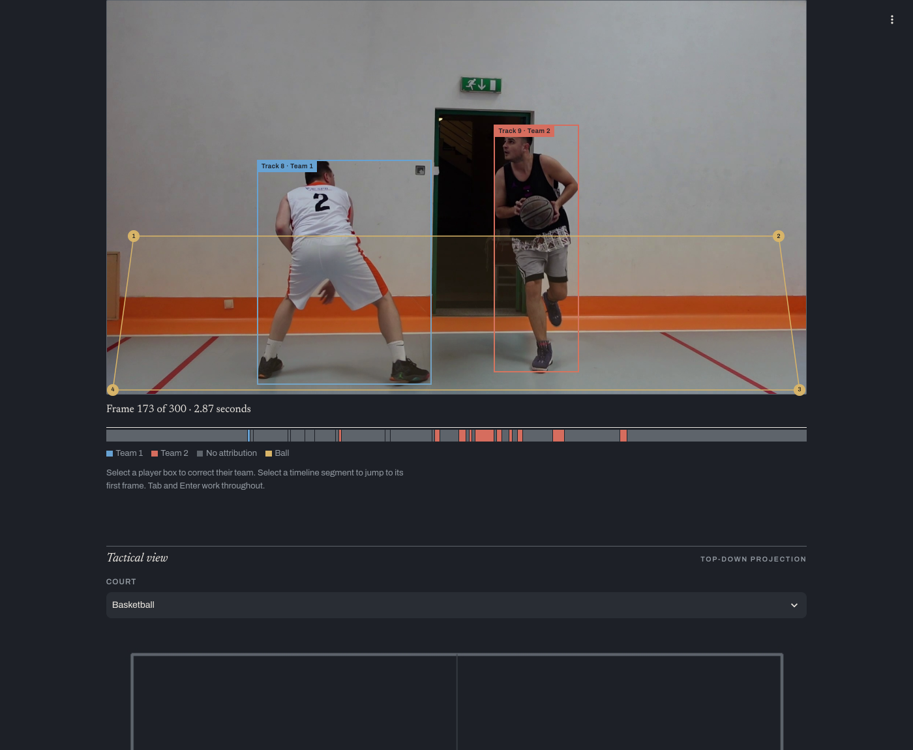
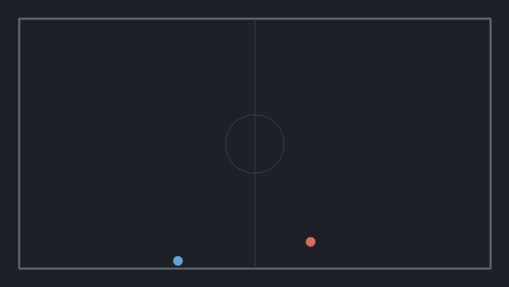

# SportVision

Turn a short sports clip into an annotated video you can review and share. Choose jersey colors, follow the processing preview, and download the video and a report showing how much ball evidence was available.

[](https://pypi.org/project/sportvision/)
[](https://pypi.org/project/sportvision/)
[](LICENSE)
[](https://colab.research.google.com/github/MohibShaikh/sportvision/blob/master/sportvision_colab.ipynb)



Listed in [Roboflow's Community Plugins](https://inference.roboflow.com/workflows/community_plugins/) ([merged listing](https://github.com/roboflow/inference/pull/2163)).

[Try the browser app](#try-the-browser-app) · [Tactical view](#tactical-view) · [Use the Workflow blocks](#roboflow-workflows-plugin) · [Report a problem](https://github.com/MohibShaikh/sportvision/issues)

## Try the browser app

Requires Python 3.10 or newer.

```bash
pip install --upgrade "sportvision[app]"
sportvision app
```

Open **http://localhost:8501** if your browser does not open automatically.

1. Upload an MP4, MOV, AVI, or MKV clip (up to 200 MB).
2. Choose the two jersey colors, or try automatic grouping. Start with 300 frames.
3. Select **Analyze clip**, then click a player box to choose their team or mark them **Referee / ignore**. The choice follows that track throughout the clip; **Restore automatic assignment** undoes it.
4. Click the colored timeline or move the frame slider to inspect the evidence. Gray segments explain why no possession was attributed. If the model missed a visible ball, turn on **Mark a missed ball on this frame** and click the ball. Use **Correct possession for this frame** to confirm the team from the video. These edits are labeled manual and affect only that frame.
5. Download the report. After a correction, select **Build corrected video** to export matching annotations without running detection again.

## Tactical view



Turn on **Set the court corners** in the review section, then click the four corners of the playing area in this order: far left, far right, near right, near left. Pick the court that matches your footage and the projection appears beside the frame.

Each dot is one player's feet, run through a homography. A wrong team assignment upstream puts a dot in the wrong color here, and a dropped track makes a dot vanish. The projection also assumes the camera holds still, so a pan or a zoom slides every dot off its real position and you have to set the corners again. The view drops anyone who lands outside the lines, because the detector cannot tell a substitute or an official from a player on the court.

Track corrections do not reconnect identities after an ID switch. Review them where players overlap or leave the picture. The report keeps original team measurements alongside your changes.

[Evaluation guide and provisional labels](docs/evaluation/README.md)

Your video is processed on your computer. No account or API key is needed. Model weights download on first use. Processing may take longer than the clip.

For development from a cloned checkout, use `pip install -e ".[app]"`.

Start with a short, steady basketball practice clip where both teams wear distinct shirts. This is the initial evaluation target, not a claim of validated basketball accuracy. Possession remains a pixel-proximity estimate: missing evidence is shown explicitly. Track IDs are not player identities.

<details>
<summary>Having trouble?</summary>

- **Command not found:** activate the Python environment where you installed the app. You can also run `python -m streamlit run src/sportvision/app.py` from the repository.
- **Port in use:** run `sportvision app --port 8502`.
- **Video cannot open:** try a shorter MP4 that plays in your usual video player.
- **First run seems slow:** allow the detector weights to download. Error details appear below the message if that fails.
- **No possession estimate:** review the detected ball and team colors. This means there was no valid attribution, not that possession was 50/50.

</details>

**Status: alpha.** An experimental clip-review app and developer toolkit. Automatic field calibration, verified player identities, and validated match statistics are not available.

## What works

- The pipeline combines COCO detection, ByteTrack from `trackers`, jersey-color clustering, annotations, and a nearest-player possession estimate.
- Speed, distance, heatmap, and homography utilities are available separately; the pipeline does not compute them automatically.
- Four optional Roboflow Workflow blocks expose filtering, team clustering, possession, and distance calculations.

## Run a clip

From this repository:

```bash
pip install -e . ultralytics
python examples/demo.py --source match.mp4 --output analyzed.mp4 --model yolov8n.pt --max-frames 300
```

This writes `analyzed.mp4` and `analyzed.json`, including processed-frame count, tracked-ball coverage, track count, and estimated possession. Model weights may download on first use. For RF-DETR, install `"sportvision[inference]"` and pass `--model rfdetr-base`.

For one frame:

```python
import cv2
from sportvision.pipeline import SportVisionPipeline

frame = cv2.imread("match.jpg")
if frame is None:
    raise ValueError("Could not read match.jpg")
pipeline = SportVisionPipeline(model="yolov8n.pt")
result = pipeline.process_frame(frame)
cv2.imwrite("annotated.jpg", result["annotated_frame"])
print(result["stats"])
```

Install `sportvision` and `ultralytics` to use the Python example outside this repository. Missing detection backends and inference/tracking errors raise exceptions instead of producing apparently successful empty results.

## Interpreting results

- Pretrained COCO models distinguish people and sports balls. They do not distinguish players, referees, goalkeepers, or spectators. Use footage with a clear view of the playing area.
- Team IDs are arbitrary color clusters, not home/away identities. Classification starts after enough players are visible; unknown teams are `-1`. Similar kits, shadows, and partial views can confuse it.
- Possession is the share of attributed observations within a pixel-distance threshold, not official possession or a share of all match time. `{}` means no estimate is available. Missing balls and unassigned observations do not count.
- Track IDs can change through occlusion; track count is not a count of unique players.
- Physical speed requires positions in meters and correct frame times. Distance uses the input coordinate units. A fixed homography is unsuitable after camera movement without recalibration. Heatmaps accept grid coordinates, not arbitrary image pixels.
- `detect_every=N` reuses old boxes for display between detections. `fresh_detections` identifies measured frames; skipped frames do not update team or possession estimates. This can miss fast ball movement.
- `infer_size` resizes the input before inference; smaller images can lose small balls. It does not guarantee a smaller model tensor or real-time performance. Measure throughput and accuracy on your own clip and hardware.

## Roboflow Workflows plugin

SportVision ships as a [Roboflow Workflows](https://inference.roboflow.com/workflows/about/) plugin. Install with inference and activate:

```bash
pip install "sportvision[workflows]"
export WORKFLOWS_PLUGINS="sportvision.workflows"
```

This registers 4 blocks you can use in any Roboflow Workflow:

| Block | Type Identifier | Description |
|-------|----------------|-------------|
| Team Classifier | `sportvision/team_classifier@v1` | Clusters player detections by jersey color. `refit_every=N` to periodically refit KMeans. |
| Possession Tracker | `sportvision/possession_tracker@v1` | Estimates nearest-player ball proximity per team. Warns when `team_id` is missing. |
| Distance Calculator | `sportvision/distance_calculator@v1` | Cumulative distance per tracked player. Supports `homography_matrix` for field-unit distances. |
| Sports Detection Filter | `sportvision/sports_detection_filter@v1` | Filters COCO detections to sports classes. |

### Using blocks directly in Python

```python
import cv2
import numpy as np
import supervision as sv

from sportvision.workflows.team_classifier.v1 import TeamClassifierBlockV1
from sportvision.workflows.possession_tracker.v1 import PossessionTrackerBlockV1
from sportvision.workflows.distance_calculator.v1 import DistanceCalculatorBlockV1
from sportvision.workflows.sports_detection_filter.v1 import SportsDetectionFilterBlockV1

# --- Filter COCO detections to sports classes ---
det_filter = SportsDetectionFilterBlockV1()
# Assume `raw_detections` comes from a COCO model (person=0, sports_ball=32)
result = det_filter.run(detections=raw_detections)
detections = result["detections"]  # now player=0, ball=1

# --- Classify players into teams ---
team_block = TeamClassifierBlockV1()
# `image` must have a .numpy_image attribute (or use WorkflowImageData)
# refit_every=10 refits KMeans every 10 frames (0 = fit once, default)
result = team_block.run(image=image, detections=detections, n_teams=2, refit_every=10)
detections = result["detections"]  # detections.data["team_id"] is now set

# --- Track possession ---
possession_block = PossessionTrackerBlockV1()
result = possession_block.run(
    detections=detections,
    ball_class_id=1,
    ball_proximity_threshold=100.0,
)
print(result["possession_stats"])   # {0: 0.6, 1: 0.4}
print(result["possessing_team"])    # 0
print(result["warning"])            # "" or warning if team_id missing

# --- Compute distances ---
# Supply detections after a tracking step that assigns persistent tracker_id values.
distance_block = DistanceCalculatorBlockV1()
# Optional: pass a 3x3 homography matrix for field-unit distances (e.g. meters)
result = distance_block.run(detections=detections, homography_matrix=[[0.01,0,0],[0,0.01,0],[0,0,1]])
print(result["detections"].data["distance"])  # cumulative distance per tracker
```

### Workflow step fragment (tracking required)

The following is a step fragment, not a complete runnable workflow. Connect a tracker
between `teams` and `distance`: the distance block requires persistent `tracker_id`
values. Create one set of stateful blocks per video and process frames in order.
Periodic team refitting can change assignments; use `refit_every=0` for a fixed model.

```json
{
  "steps": [
    {
      "type": "sportvision/sports_detection_filter@v1",
      "name": "filter",
      "detections": "$steps.model.predictions"
    },
    {
      "type": "sportvision/team_classifier@v1",
      "name": "teams",
      "image": "$inputs.image",
      "detections": "$steps.filter.detections",
      "n_teams": 2,
      "refit_every": 10
    },
    {
      "type": "sportvision/possession_tracker@v1",
      "name": "possession",
      "detections": "$steps.teams.detections",
      "ball_proximity_threshold": 100.0
    },
    {
      "type": "sportvision/distance_calculator@v1",
      "name": "distance",
      "detections": "$steps.tracker.detections",
      "homography_matrix": [[0.01,0,0],[0,0.01,0],[0,0,1]]
    }
  ]
}
```

## Architecture

```
src/sportvision/
├── detection.py      # SportsDetector, wraps COCO detectors, maps to sports classes
├── tracking.py       # SportsTracker, ByteTrack via trackers
├── teams.py          # TeamClassifier, KMeans on HSV jersey histograms
├── homography.py     # FieldHomography, pixel to field coords
├── analytics/
│   ├── possession.py # PossessionTracker, nearest player to the ball per frame
│   ├── speed.py      # SpeedEstimator, displacement over time to km/h
│   ├── distance.py   # DistanceCalculator, cumulative path length
│   └── heatmap.py    # HeatmapGenerator, 2D histogram plus gaussian blur
├── annotators.py     # TeamColorAnnotator, StatsOverlayAnnotator, TrailAnnotator
├── pipeline.py       # SportVisionPipeline, orchestrates all modules
└── workflows/            # Roboflow Workflows plugin
    ├── _compat.py        # Inference compatibility shim
    ├── kinds.py          # Custom kind definitions
    ├── team_classifier/  # Team classification block
    ├── possession_tracker/   # Possession tracking block
    ├── distance_calculator/  # Distance calculation block
    └── sports_detection_filter/  # COCO→sports filter block
```

## Sports class IDs

| ID | Class |
|----|-------|
| 0 | Player |
| 1 | Ball |
| 2 | Referee |
| 3 | Goalkeeper |

## Dependencies

| Package | Purpose | Required |
|---------|---------|----------|
| numpy | Arrays | Yes |
| opencv-python | Image processing, annotation | Yes |
| supervision | Detection data structures | Yes |
| trackers | ByteTrack implementation | Yes |
| scikit-learn | KMeans for team classification | Yes |
| pydantic | Workflow block manifests | Yes |
| inference | Roboflow Workflows engine | Optional (`[workflows]`) |
| ultralytics | YOLOv8 detection | Optional |
| rfdetr | RF-DETR detection | Optional (`[inference]`) |

## Development

```bash
git clone https://github.com/MohibShaikh/sportvision.git
cd sportvision
pip install -e ".[all]"

# Tests
pytest tests/ -v

# Lint
ruff check src/ tests/ && ruff format --check src/ tests/
```

## License

Apache-2.0


### Analysis detail and limitations

The local app defaults to **Detailed**: YOLO runs at 1280 pixels with a 0.15
ball confidence threshold; player confidence remains 0.25. **Quick** uses 640
pixels and 0.25 for both. Detailed takes longer and may detect more false balls;
its name is not an accuracy guarantee. Python and the example CLI retain Quick
by default; pass `analysis_mode="detailed"` or `--analysis-mode detailed`.

Balls are retained as detector observations separately from player tracking.
Their track ID is -1: they are not assigned a persistent identity. Unconfirmed
player IDs are excluded from the unique-track count. The legacy report key
`frames_with_tracked_ball` now counts frames with detected balls.

Detailed possession uses the distance from the ball center to a player's bounding
box, allowing up to 15% of that player's height. If more than one player qualifies,
it reports uncertainty. This handles scale and balls near hands more sensibly,
but is still a heuristic: nearby players do not establish control of the ball.
Quick retains the original 50-pixel center-distance rule. Reports record the
chosen method, and manual corrections replay that same method.

See [reproducible evaluation](docs/evaluation/README.md) for the small diagnostic
and what still needs independent validation before production accuracy claims.
